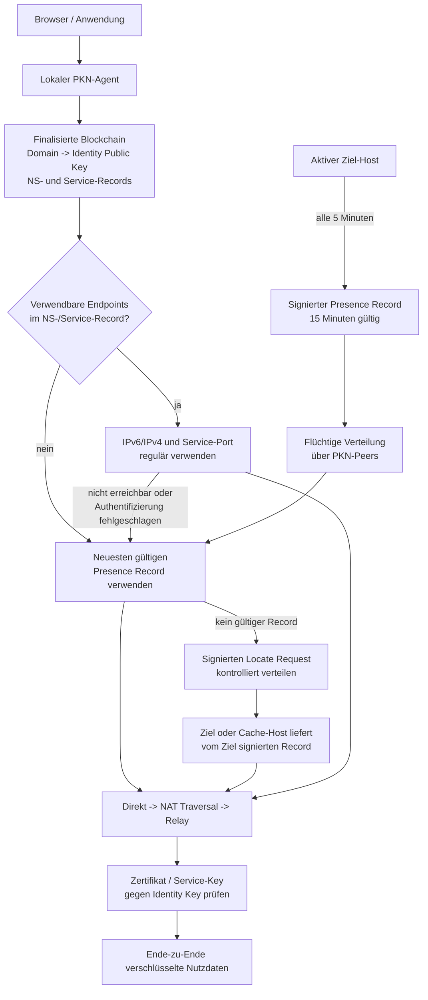

> [!CAUTION]
> AI was used for ideation and architecture development in this repository.
> 
> AI was used to generate [assets](assets/) in this repository.

# Public Key Network

```info
Projektname: Public Key Network
Kurzname:    PKN
Repository:  public-key-network
Ziel-TLD:    .pkn
Status:      Architekturentwurf
```

Public Key Network (PKN) ist ein dezentrales Namens-, Presence- und Verbindungsnetz. Eine `.pkn`-Domain ist dauerhaft an einen Identity Public Key gebunden. Im NS-Record eingetragene IPv4-/IPv6-Adressen und Service-Endpoints werden regulär verwendet. Presence und Discovery greifen ein, wenn kein passender Endpoint eingetragen oder kein eingetragener Endpoint erreichbar ist.

## Vertrauensmodell

```text
Domain       -> Identity Public Key
IP/Port      -> Transportweg
Zertifikat   -> Service-Identität
Signatur     -> Integrität und Berechtigung
Handshake    -> aktueller Besitznachweis
```

Der Identity Public Key im finalisierten Blockchain-State ist die Vertrauenswurzel einer Domain. IP-Adressen, Presence-Caches, Bootstrap-Nodes und Relays bestimmen nur die Erreichbarkeit.

Zertifikate und Service-Schlüssel für beispielsweise HTTPS, Mail, XMPP oder andere Dienste sind gültig, wenn sie:

- direkt dem Identity Public Key entsprechen, oder
- über eine lückenlose, gültige und zweckgebundene Delegationskette zum Identity Public Key führen,
- zur Domain, zum Dienst, zum Protokoll und gegebenenfalls zum Port passen,
- nicht abgelaufen oder widerrufen sind,
- im aktuellen Handshake durch Kontrolle des zugehörigen Private Keys bestätigt werden.

## Gesamtarchitektur



## Blockchain-Records

### NS-Record

Jede `.pkn`-Domain besitzt einen finalisierten NS-Record:

```text
NSRecord {
    version
    network_id
    domain
    identity_public_key

    ipv4_addresses[]
    ipv6_addresses[]
    default_port
    default_transport
    service_records[]

    delegation_root
    sequence_number
    registered_at
    domain_valid_until
    signature
}
```

`identity_public_key` ist verpflichtend. Die Endpoint-Listen dürfen leer sein. Sobald ein Endpoint eingetragen ist, gehört er zum regulären Auflösungs- und Verbindungsprozess.

Signiert wird der vollständige kanonische Record. Änderungen erfordern eine höhere Sequenznummer und eine gültige Registry-Signatur.

### Service-Record

Dienste können eigene Adressen, Ports, Protokolle und Zertifikatsbindungen besitzen:

```text
ServiceRecord {
    service
    hostname
    ipv4_addresses[]
    ipv6_addresses[]
    port
    transport
    priority
    certificate_public_key
    certificate_delegation
    valid_until
}
```

Beispiele für `service`:

```text
https
mail-smtp
mail-imap
xmpp-client
xmpp-server
api
custom
```

Ein Service-Record erweitert den NS-Record. Er ersetzt niemals den Identity Public Key als Vertrauenswurzel.

## Verbindliches Endpoint-Verhalten

```text
Identity Public Key fehlt:
    Record ist ungültig.

IPv4 und IPv6 vorhanden:
    passende Adressen nach Priorität und Happy Eyeballs versuchen;
    erste erfolgreich authentifizierte Verbindung verwenden.

Nur IPv6 vorhanden:
    IPv6 regulär verwenden;
    bei Fehlschlag Presence und Discovery verwenden.

Nur IPv4 vorhanden:
    IPv4 regulär verwenden;
    bei Fehlschlag Presence und Discovery verwenden.

Keine IP-Adresse vorhanden:
    Presence Cache verwenden;
    falls kein gültiger Record vorhanden ist, Discovery starten.

Service-Record vorhanden:
    dessen Adressen, Port, Transport und Zertifikatsbindung verwenden.

Kein Service-Record vorhanden:
    NS-Standardendpoint und den normativ definierten Dienststandard verwenden.

Port nicht gesetzt:
    normativ festgelegten Standardport des Dienstes verwenden.

Transport nicht gesetzt:
    normativ festgelegten Standardtransport des Dienstes verwenden.

Endpoint syntaktisch ungültig:
    nur diesen Endpoint ignorieren.

Endpoint nicht erreichbar:
    nächsten eingetragenen Endpoint versuchen;
    danach Presence, NAT Traversal und Relay verwenden.

Endpoint erreichbar, Identitätsprüfung schlägt fehl:
    Verbindung sofort verwerfen;
    Endpoint nicht als gültiges Ziel akzeptieren;
    weitere Endpoints beziehungsweise Presence versuchen.
```

## Identität und Schlüssel

Beim ersten Start erzeugt die Software lokal einen Master Seed. Daraus werden deterministisch getrennte Schlüssel abgeleitet:

```text
Identity Key   -> dauerhafte Identität und Delegationswurzel
Registry Key   -> Domain-, NS- und Service-Records
Discovery Key  -> Presence und Discovery Sessions
Transport Key  -> Verbindungs- und Zertifikatsauthentifizierung
Recovery Key   -> optionale Notfallrotation
```

Master Seed und Private Keys verlassen das Gerät niemals.

Für eine identische Wiederherstellung müssen unverändert bleiben:

```text
Master Seed
network_id
KDF und KDF-Parameter
Key-Version
Kryptografie-Suite
```

Nach einer Neuinstallation wird aus demselben Master Seed dieselbe Identity erzeugt. Domains, Records und Delegationen werden aus dem finalisierten Blockchain-State geladen. Eine erneute Registrierung ist nicht erforderlich.

## Key-Swap

Ein Identity-Wechsel erfolgt atomar:

1. Neue Identity lokal erzeugen.
2. Transfer mit alter Identity signieren.
3. Übernahme mit neuer Identity signieren.
4. Domains und Delegationen im selben finalisierten Zustandswechsel übertragen.
5. Neue Service- und Zertifikatsdelegationen aktivieren.
6. Alte Schlüssel für neue Operationen widerrufen.
7. Alten Seed erst nach Finalisierung und getesteter Wiederherstellung löschen.

## Presence Records

Ein aktiver Host veröffentlicht alle fünf Minuten einen signierten Presence Record. Presence Records werden nicht in Blöcken gespeichert.

```text
PresenceRecord {
    version
    network_id
    identity_public_key
    discovery_session_public_key
    session_delegation
    sequence_number
    created_at
    valid_until
    direct_candidates[]
    nat_candidates[]
    relay_candidates[]
    capabilities[]
    signature
}
```

```text
Sendeintervall: 5 Minuten
Gültigkeit:     15 Minuten
```

Pro Identity wird nur der Record mit der höchsten gültigen Sequenznummer verwendet. Akzeptiert werden ausschließlich Records mit gültiger Signatur, Delegation, `network_id`, Identity-Bindung und Ablaufzeit.

Abgelaufene Records werden nicht als Locator verwendet. Sie dürfen lokal nur darauf hinweisen, welche Cache-Nodes zuletzt erfolgreich waren.

## Discovery

Wenn kein eingetragener Endpoint funktioniert und kein gültiger Presence Record lokal vorliegt:

1. Quelle erstellt einen signierten Locate Request für den Ziel-Public-Key.
2. Request wird kontrolliert über bestehende PKN-Peer-Verbindungen verteilt.
3. Jeder Node verarbeitet dieselbe Request-ID nur einmal.
4. Es wird keine Route aus dem Public Key oder dessen Hash berechnet.
5. Ziel oder Cache-Host mit gültigem Presence Record antwortet.
6. Cache-Hosts dürfen ausschließlich unveränderte, vom Ziel signierte Records liefern.
7. Antwort verwendet kurzlebig gespeicherte Reverse Paths.
8. Bei Pfadausfall ist begrenzte redundante Antwortverteilung zulässig.
9. Discovery-Daten laufen nach TTL oder erfolgreichem Verbindungsaufbau ab.

PKN verwendet kontrolliertes Gossip und kein Hash-Distanz- oder Baum-Routing.

### Reihenfolge der Presence-Suche

```text
1. lokaler gültiger Presence Record
2. Cache-Nodes der letzten erfolgreichen Sitzung
3. aktuell verbundene PKN-Peers
4. allgemeine kontrollierte Discovery
```

## Transport und NAT

Der lokale PKN-Agent versucht:

```text
1. eingetragene IPv6-/IPv4-Service-Endpoints
2. direkte Candidates aus Presence
3. NAT Traversal
4. Relay
```

NAT Traversal und Relay werden nur für den Verbindungsaufbau beziehungsweise als Transportweg verwendet. Nach erfolgreichem Aufbau laufen Nutzdaten direkt oder Ende-zu-Ende verschlüsselt über einen Relay. Andere PKN-Peers transportieren keine Nutzdaten der Sitzung.

Öffentlich erreichbare Nodes dürfen signiert folgende Capabilities anbieten:

```text
PRESENCE_CACHE
NAT_OBSERVER
NAT_COORDINATOR
RELAY
BOOTSTRAP
```

Keiner dieser Nodes entscheidet über Identity, Domainbesitz oder Zertifikatsgültigkeit.

## Authentifizierter Handshake

Jede neue Verbindung verwendet einen ephemeren Schlüsselaustausch. Beide Seiten signieren das vollständige Handshake-Transkript mit einem gültig delegierten Transport- oder Service-Key.

Geprüft werden mindestens:

- erwartete Domain und Identity,
- Service und Protokoll,
- Zertifikats- beziehungsweise Schlüssel-Delegation,
- Ablauf und Widerruf,
- beide ephemeren Schlüssel,
- ausgehandelte Algorithmen,
- Request-ID beziehungsweise Sitzungskontext.

Danach werden getrennte Richtungsschlüssel und ein Rekey-Schlüssel abgeleitet. Nutzdaten werden ausschließlich authentifiziert verschlüsselt übertragen.

## Lokaler PKN-Agent

Jede Installation betreibt einen lokalen Agenten für:

- `.pkn`-Auflösung,
- Verarbeitung von NS- und Service-Records,
- Schlüsselableitung und lokale Schlüsselverwaltung,
- Blockchain-Synchronisierung und Proof-Prüfung,
- Peer- und Presence-Cache,
- Presence-Publikation,
- Discovery,
- IPv4-/IPv6- und Service-Endpoint-Auswahl,
- NAT Traversal und Relay-Auswahl,
- Zertifikats-, Service- und Handshake-Prüfung,
- lokale API für Browser, Plugins und Anwendungen.

Die API wird ausschließlich über einen authentifizierten Unix Socket oder Loopback-Endpunkt angeboten.

## Erstmaliger Netzwerkstart

Während der Aufbauphase stellt ein zentral betriebener Server bereit:

- signierte Software-Releases,
- Genesis-Daten und `network_id`,
- bekannten authentifizierten Bootstrap-Endpoint,
- initiale Blockchain-Synchronisierung,
- Liste öffentlich erreichbarer Nodes,
- bei Bedarf Presence-, NAT- und Relay-Hilfe.

Der Client überträgt ausschließlich öffentliche Schlüssel und signierte Protokollnachrichten. Master Seed und Private Keys werden niemals übertragen.

Der Startserver ist Bootstrap- und Transporthilfe. Blockchain-Zustände werden immer lokal validiert.

## Übergang zum dezentralen Betrieb

Die Software wechselt anhand des finalisierten Blockchain-Zustands automatisch in den dezentralen Modus. Die Aktivierung berücksichtigt mindestens:

- festgelegte Mindestzahl registrierter und aktiver Teilnehmer,
- mehrere unabhängige öffentliche Nodes,
- mehrere aktive Validatoren,
- stabile Finalität über mehrere Epochen,
- Verteilung auf unabhängige Netzbereiche.

Der geplante Wert von ungefähr 1.000 Identitäten reicht allein nicht aus, sondern ist nur eine Mindestbedingung.

Nach Aktivierung:

- besitzt der ursprüngliche Server keine besondere Blockchain-Rolle,
- kann er keine Zustände allein finalisieren,
- kann er keine Teilnehmer zulassen oder sperren,
- kann er keine Protokollparameter allein ändern,
- wird er höchstens als normaler Node behandelt,
- darf er weiterhin signierte Software und öffentliche Node-Listen verteilen.

## Öffentliche Node-Liste und Wiederanbindung

Der Software-Server erfasst ausschließlich freiwillig öffentlich angebotene Nodes:

```text
PublicNodeEntry {
    node_identity_public_key
    public_ipv4_addresses[]
    public_ipv6_addresses[]
    port
    transport
    capabilities[]
    last_successful_check
    identity_proof
}
```

Er erfasst keine Private Keys, Master Seeds, lokalen IP-Adressen, Nutzdaten oder nicht öffentlich angebotenen Nodes.

Die Liste ist Bootstrap-Hilfe und keine Vertrauensquelle. Jeder Node wird beim Verbindungsaufbau kryptografisch authentifiziert.

Startreihenfolge:

```text
1. lokalen Blockchain-State laden
2. Peers der letzten Sitzung kontaktieren
3. bekannte Presence-Cache-Nodes befragen
4. integrierte öffentliche Nodes versuchen
5. Software-Server als zusätzlichen Bootstrap-Fallback verwenden
6. mehrere unabhängige Peers authentifizieren
7. finalisierten State synchronisieren
8. eigenen Presence Record erneuern
```

Nach langer Offline-Zeit kann die aktuelle signierte Software erneut geladen und mit dem vorhandenen Master Seed dieselbe Identity wiederhergestellt werden.

## Domain-Lebenszyklus

- Domainregistrierung gilt für den normativ festgelegten Zeitraum.
- Verlängerung erfolgt mit dem gültigen Registry Key.
- Nach Ablauf gilt eine definierte Grace Period.
- Danach wird die Domain erneut registrierbar.
- Subdomains und Services werden vom Besitzer signiert verwaltet.
- Änderungen an NS- oder Service-Records erhöhen die Sequenznummer.
- Key-Swap überträgt Domains und Delegationen atomar.

## Sicherheitsregeln

- Identity Public Key ist in jedem gültigen NS-Record verpflichtend.
- Eingetragene Endpoints werden regulär verwendet.
- Leere Endpoint-Listen lösen Presence und Discovery aus.
- IP-Adressen und Relays sind Locator, keine Identitäten.
- Zertifikate und Services müssen auf die Blockchain-Identity zurückführbar sein.
- Sämtliche sicherheitsrelevanten Records werden kanonisch kodiert und signiert.
- Ungültige, abgelaufene, widerrufene oder ältere Records werden verworfen.
- Request-IDs, Sequenznummern, Nonces und TTLs verhindern Replays.
- Paket-, Cache-, Bandbreiten- und Relay-Ressourcen besitzen harte Grenzen.
- Günstige Prüfungen erfolgen vor teuren kryptografischen Operationen.
- Bei hoher Last darf adaptiver Proof of Work verlangt werden.
- Relays erhalten keinen Zugriff auf Klartext oder Sitzungsschlüssel.
- Unprüfbare Sicherheitsentscheidungen werden fail-closed abgelehnt.
- DDoS wird begrenzt, kann physisch jedoch nicht ausgeschlossen werden.

## Softwareanforderungen

### Node Core

- Full-, Pruned- und Compact-Blockchain-Modus,
- Finalitäts-, State- und Merkle-Proof-Prüfung,
- authentifizierte Peer-Verbindungen,
- Presence-Gossip und Presence-Cache,
- Locate Request und Locate Response,
- Replay-, TTL-, Quoten- und Ressourcenlimits,
- direkte, NAT- und Relay-Verbindungen,
- Ende-zu-Ende-Handshake und verschlüsselte Sitzung.

### Key Manager

- Master Seed sicher erzeugen, anzeigen und importieren,
- dieselbe Identity deterministisch wiederherstellen,
- zweckgebundene Schlüssel ableiten,
- Delegationen und Widerrufe verwalten,
- optionalen Recovery Key verwalten,
- atomaren Key-Swap durchführen,
- Private Keys verschlüsselt speichern.

### Domain-, NS- und Service-Manager

- Domains registrieren, verlängern, übertragen und freigeben,
- IPv4-/IPv6-Listen vollständig verwalten,
- Ports, Transporte und Prioritäten verwalten,
- Service-Records für Web, Mail, XMPP und weitere Dienste verwalten,
- Zertifikats- und Service-Key-Delegationen erzeugen und prüfen,
- Records kanonisch signieren,
- Sequenznummern automatisch erhöhen,
- Domainstatus, Ablauf und Proofs anzeigen.

### Network Agent

- `.pkn`-Resolver und lokale API,
- NS- und Service-Records auswerten,
- öffentliche Adressen und NAT-Typ erkennen,
- Presence Record alle fünf Minuten erneuern,
- Cache-Nodes der letzten Sitzung befragen,
- Peers und Bootstrap-Quellen verwalten,
- Endpoints nach Priorität und Happy Eyeballs versuchen,
- NAT Traversal und Relay-Circuits verwalten.

### Betrieb

- signierte Softwareupdates,
- sichere Release-Key-Rotation,
- versionierte Datenmigration,
- datensparsame Logs ohne Secrets,
- standardmäßig deaktivierte Telemetrie,
- Diagnose für Chain, Peers, Presence, Discovery, Services und Verbindungen.

## Normativ noch festzulegende Parameter

Vor einer interoperablen Implementierung müssen festgelegt werden:

- Kryptografie-Suite,
- kanonisches Binärformat,
- Konsensverfahren und Sybil-Schutz,
- Aktivierungsbedingungen des dezentralen Modus,
- Domainlaufzeit und Grace Period,
- Standardports und Standardtransporte je Dienst,
- IPv4-/IPv6-Verbindungsstaffelung,
- maximale Adress- und Service-Anzahl pro Record,
- Paket-, Cache-, Fan-out- und Hop-Limits,
- Proof-of-Work-Grenzen,
- NAT-, QUIC-, TCP- und Relay-Parameter,
- Release-Key-Rotation und Governance.

## Projektstatus

PKN ist ein Architekturentwurf. Vor einem öffentlichen Testnetz sind normative Paketformate, Testvektoren, Interoperabilitätstests, Fuzzing, Konsenssimulationen, Lasttests und unabhängige Sicherheitsprüfungen erforderlich.
