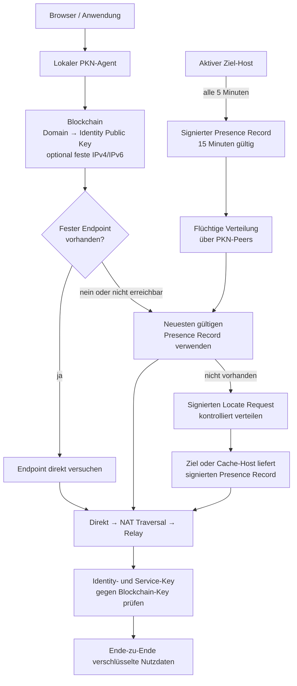

> [!CAUTION]
> Disclaimer: AI was used for ideation and vision development in this repository.

# Public Key Network

```info
Projektname: Public Key Network
Kurzname:    PKN
Repository:  public-key-network
Ziel-TLD:    .pkn
Status:      Architekturentwurf
```

Public Key Network (PKN) ist ein dezentrales Namens-, Presence- und Verbindungsnetz. Eine `.pkn`-Domain verweist auf eine kryptografische Identität. Öffentliche IP-Adressen, NAT-Kandidaten und Relays dienen ausschließlich der Erreichbarkeit und begründen kein Vertrauen.

## Grundprinzip

```text
Domain       → Identity Public Key
Public Key   → eindeutige Identität
IP/Port      → optionaler Transportweg
Presence     → kurzlebige dynamische Erreichbarkeit
Signatur     → Integrität und Kontrolle der Identität
Handshake    → aktueller Besitznachweis
```

Der in der Blockchain registrierte Identity Public Key ist die Vertrauenswurzel einer Domain. Zertifikate, Discovery-Schlüssel, Transport-Schlüssel und Service-Schlüssel müssen entweder diesem Key entsprechen oder über eine gültige, zweckgebundene Signaturkette auf ihn zurückgeführt werden können.

## [Architektur](https://www.devtoolsdaily.com/diagrams/mermaidjs/playground/?#v2=N4IgtghgTg1grgBxALhAMwDYHsDuBjAC2gBcACAFQCEAdAO1IdIEEAFFgbWpEqlwGcAplFIB6ZrRwDaAEzi0A5lwC6pALSqAfMwDiAUQBy5TiAAyWGBAxDSLANL7VTeVOLK6jHQfJrNpAMIAEkwAkvrGlNh4MIQQAJa0ADwARlAiGgAiWJDxpIBJhKTB0i6xxACeNnBJGLF4pLYCpcmpGlgIxLFYtJakaAJ8xAIFLABuACwiwSMAbG607ozkTABKekZcTDDtw9YAWrECGKoBWP3KPhoAPlyWVqQArKQAsvFwA3MgFzZLugDKBn66Yw-WLyWj7KADYQsKB9KR4QZLAR4LBQaRNNIARgez1orykpHkAB+MO1FCAlPMGCxvn99ADzk9fgFjAAxDCEwikwYANSEA1iGDk8nRGkJSWsdgcLAEQj4s0p-iCoQZP0W5GCfmAXBZfUhpF0MgQWHixBFwxRRBkUgA-FwAL4K1VMdV+c5XEAAKwgXE+6WC3z8axABukRpNpGksRhm1I2ygfDghCksw8Tpdbq4tAEOSwRWEYM5pCEMJqBCS0B9-iYgUBXH0AjguvxRJJIKkIuhsNo8NIiORqNjQkkVveFPojEeTIZfmrAV0CpnNYzIALBDI5qglqK719wR+fgA8tzdEsAJpAkFgvn4sx4CADXsCACOjf6IpgnWIvAw1T5g4h2ZWKOCp+vuR4nqeDI0iwB76H8xh7AcpC5tYfgQEmRwnGQv69BCIp8Je4JvDYMKCN2CJIii0jyuODB+gG3jqFoh76PouiBsY6RRgIMb5PozoUFAEBxnw3T5IiGAQKUKaMIuc7TrBbGBgq0GwX8Cmsex5ALopWkMkwACq5DMlwhTFGUqikHI0ikD8QjDDUAiqPUjQpGkzjOPQERYFEMTxM5DSkAgUCEr0wG0cwRkBAy6TOkwxghk5ABecCqIl-58IQ7J8IIJKDPorxJdI97JuSIB2kAA)



## Blockchain-Daten

Ein Domain-Datensatz enthält mindestens:

```text
NameRecord {
    domain
    owner_identity_public_key
    optional_static_endpoints[]
    delegation_root
    sequence_number
    registered_at
    valid_until
    signature
}
```

Die Blockchain speichert dauerhaft:

- Domain und Identity Public Key,
- optionale feste öffentliche IPv4-/IPv6-Endpoints,
- Delegationen und Widerrufe,
- Domainablauf und Sequenznummer,
- atomare Key- und Domaintransfers,
- finalisierte State Roots und Konsensdaten.

Nicht dauerhaft gespeichert werden:

- Presence Records,
- Locate Requests und Responses,
- NAT- und Relay-Zustände,
- Reverse Paths,
- Verbindungs- und Nutzdaten.

## Identität und Wiederherstellung

Beim ersten Start erzeugt die Software lokal einen Master Seed. Aus diesem werden deterministisch getrennte Schlüssel abgeleitet:

```text
Identity Key
Registry Key
Discovery Key
Transport Key
optional Recovery Key
```

Für eine identische Wiederherstellung müssen unverändert sein:

```text
Master Seed
network_id
Key-Derivation-Verfahren
Key-Version
verwendete kryptografische Algorithmen
```

Der Master Seed und sämtliche Private Keys verlassen das Gerät niemals.

Nach Neuinstallation gilt:

1. Aktuelle PKN-Software herunterladen und deren Release-Signatur prüfen.
2. Bestehenden Master Seed lokal eingeben oder importieren.
3. Dasselbe Schlüsselpaar deterministisch wiederherstellen.
4. Blockchain synchronisieren und Identity-Zustand prüfen.
5. Bekannte öffentliche Nodes kontaktieren.
6. Neuen Discovery Session Key erzeugen.
7. Presence Record veröffentlichen.
8. Bestehende Domains und Delegationen lokal laden.

Eine erneute Identity- oder Domainregistrierung ist nicht erforderlich. Ohne Master Seed oder vorher eingerichteten Recovery Key ist die Identität nicht wiederherstellbar.

## Presence Records

Jeder aktive Host veröffentlicht alle fünf Minuten einen signierten Presence Record. Er wird über das PKN-Netz verteilt und nur flüchtig gespeichert.

```text
PresenceRecord {
    identity_public_key
    discovery_session_public_key
    session_delegation
    sequence_number
    created_at
    valid_until
    direct_candidates[]
    nat_candidates[]
    relay_candidates[]
    capabilities[]
    signature
}
```

Vorgaben:

```text
Sendeintervall: 5 Minuten
Gültigkeit:     15 Minuten
```

Jeder Node speichert pro Identity nur den Record mit der höchsten gültigen Sequenznummer. Ein Record wird nur akzeptiert, wenn Signatur, Delegation, Ablaufzeit und Identity-Bindung gültig sind.

## Discovery

Wenn kein funktionierender fester Endpoint und kein lokaler gültiger Presence Record vorhanden ist:

1. Die Quelle erstellt einen signierten Locate Request für den Ziel-Public-Key.
2. Der Request wird kontrolliert über bestehende PKN-Peer-Verbindungen verteilt.
3. Jeder Node verarbeitet dieselbe Request-ID nur einmal.
4. Es wird keine Richtung aus dem Public Key oder dessen Hash berechnet.
5. Das Ziel oder ein Host mit gültigem Presence Record antwortet.
6. Cache-Hosts dürfen ausschließlich den unveränderten, vom Ziel signierten Record zurückgeben.
7. Die Antwort verwendet gespeicherte Reverse Paths; bei Ausfall ist begrenzte redundante Verteilung zulässig.
8. Nach erfolgreichem Verbindungsaufbau laufen Discovery-Daten automatisch ab.

PKN verwendet beim Discovery-Aufbau kontrolliertes Gossip, kein Baum- und kein Hash-Distanz-Routing.

## Verbindungsaufbau

Die Transportwege werden in dieser Reihenfolge versucht:

```text
1. feste signierte IPv6
2. feste signierte IPv4
3. direkte Candidates aus Presence Record
4. NAT Traversal
5. Relay
```

Ein erfolgreicher TCP-, UDP- oder QUIC-Verbindungsaufbau reicht nicht als Identitätsnachweis. Die Gegenstelle muss im Handshake einen Transport- oder Service-Key nachweisen, der gültig auf den Blockchain Identity Public Key zurückgeführt werden kann.

Der Handshake verwendet:

- ephemeren Schlüsselaustausch,
- signiertes Handshake-Transkript,
- getrennte Richtungsschlüssel,
- authentifizierte Verschlüsselung,
- Sequenznummern und Replay-Schutz,
- regelmäßiges Rekeying.

Nach Aufbau der Sitzung laufen Nutzdaten direkt zwischen den Endpunkten oder Ende-zu-Ende verschlüsselt über einen Relay. Andere PKN-Peers sind nicht beteiligt.

## Lokaler PKN-Agent

Jede Installation betreibt einen lokalen Agenten. Er übernimmt:

- `.pkn`-Auflösung,
- Schlüsselableitung und lokale Schlüsselverwaltung,
- Blockchain-Synchronisierung und Proof-Prüfung,
- Peer- und Presence-Cache,
- Presence-Publikation,
- Discovery,
- Endpoint-Auswahl,
- NAT-Erkennung und NAT Traversal,
- Relay-Auswahl,
- Handshake- und Zertifikatsprüfung,
- lokale API für Browser, Anwendungen und Plugins.

Die lokale API wird ausschließlich über Unix Socket oder Loopback angeboten und muss authentifiziert sein.

## Erstmaliger Netzwerkstart

Während der initialen Aufbauphase stellt ein zentral betriebener Server bereit:

- signierte Software-Releases,
- Genesis-Daten und `network_id`,
- einen bekannten authentifizierten Bootstrap-Endpoint,
- initiale Blockchain-Synchronisierung,
- Austausch öffentlich erreichbarer Nodes,
- bei Bedarf Presence-, NAT- und Relay-Hilfe.

Der Client sendet nur öffentliche Daten und signierte Protokollnachrichten. Master Seed und Private Keys werden niemals übertragen.

Der Startserver ist in dieser Phase Transport- und Bootstrap-Hilfe. Blockchain-Zustände müssen trotzdem lokal validiert werden.

## Übergang zum dezentralen Betrieb

Die Software wechselt automatisch und anhand des finalisierten Blockchain-Zustands in den dezentralen Betriebsmodus. Die Aktivierung darf nicht allein durch eine Behauptung des Startservers erfolgen.

Die Aktivierung berücksichtigt mindestens:

- eine festgelegte Mindestzahl registrierter und aktiver Teilnehmer,
- mehrere unabhängige öffentliche Nodes,
- mehrere aktive Validatoren,
- stabile Finalität über mehrere Epochen,
- ausreichende Verteilung auf unabhängige Netzbereiche.

Der geplante Teilnehmerwert von ungefähr 1.000 Identitäten ist eine notwendige, aber allein nicht ausreichende Bedingung.

Nach der finalisierten Aktivierung:

- besitzt der Startserver keine besondere Blockchain-Rolle mehr,
- kann er keine Zustände allein finalisieren,
- kann er keine Teilnehmer zulassen oder sperren,
- kann er keine Protokollparameter allein ändern,
- wird er höchstens als normaler Node behandelt,
- darf er weiterhin Software und öffentliche Node-Listen bereitstellen.

Der Verlust der Sonderrechte wird von allen installierten Nodes selbst aus dem finalisierten State erkannt.

## Öffentliche Node-Liste und Wiederanbindung

Der Software-Server beobachtet ausschließlich öffentlich angebotene PKN-Nodes und erstellt daraus eine Release-Node-Liste. Er speichert und verteilt dabei nur:

```text
Node Identity Public Key
öffentliche IPv4/IPv6
Port und Transport
Capabilities
Zeitpunkt der letzten erfolgreichen Prüfung
Signatur beziehungsweise Identitätsnachweis
```

Nicht erfasst oder verteilt werden:

- Private Keys oder Master Seeds,
- private oder lokale IP-Adressen,
- Nutzdaten,
- Kommunikationsinhalte,
- nicht öffentlich angebotene Nodes.

Die Liste ist Bootstrap-Hilfe und keine Vertrauensquelle. Jeder Eintrag wird beim Verbindungsaufbau kryptografisch authentifiziert.

Startreihenfolge im laufenden Betrieb:

```text
1. lokalen Blockchain-State laden
2. Peers der letzten Sitzung kontaktieren
3. zuletzt erfolgreiche Presence-Cache-Nodes befragen
4. integrierte öffentliche Nodes versuchen
5. Software-Server nur als zusätzlichen Bootstrap-Fallback verwenden
6. mehrere unabhängige Peers authentifizieren
7. finalisierten State synchronisieren
8. eigenen Presence Record erneuern
```

Ein abgelaufener Presence Record darf nur als Hinweis auf frühere Cache-Nodes dienen. Er darf nicht unmittelbar als gültiger Locator verwendet werden.

## Softwareverteilung nach der Dezentralisierung

Der ursprüngliche Server darf weiterhin:

- signierte Releases anbieten,
- Installationsdateien bereitstellen,
- aktuelle öffentliche Node-Listen in neue Releases einbinden,
- einen normalen Bootstrap-Endpoint betreiben,
- Dokumentation und Testvektoren veröffentlichen.

Er erhält dadurch keine Kontrolle über Blockchain, Identitäten, Domains oder Konsens.

Die Software muss mehrere Release- und Bootstrap-Quellen unterstützen. Release-Dateien werden vor Installation gegen fest verankerte Release Keys geprüft.

## Domain-Lebenszyklus

- Eine Domain ist für einen festgelegten Zeitraum registriert.
- Der Besitzer verlängert sie mit dem gültigen Registry Key.
- Nach Ablauf gilt eine definierte Grace Period.
- Danach wird die Domain wieder registrierbar.
- Subdomains werden vom Besitzer signiert verwaltet.
- Ein Key-Swap benötigt die Signatur der alten und neuen Identity.
- Domains werden beim Key-Swap atomar und ohne Zwischenfreigabe übertragen.

## Sicherheitsregeln

- Identity Public Key aus der finalisierten Blockchain ist die alleinige Vertrauenswurzel.
- IP-Adressen, Bootstrap-Listen, Presence-Caches und Relays bestimmen nur Erreichbarkeit.
- Alle sicherheitsrelevanten Strukturen werden kanonisch kodiert und signiert.
- Ungültige, abgelaufene, widerrufene oder ältere Records werden verworfen.
- Request-IDs, Sequenznummern, Nonces und TTLs verhindern Wiederholungen.
- Paket-, Cache-, Bandbreiten- und Relay-Ressourcen besitzen harte Grenzen.
- Format, Version, Größe, TTL und Limits werden vor teurer Kryptografie geprüft.
- Bei hoher Last darf adaptiver Proof of Work verlangt werden.
- Relays erhalten keinen Zugriff auf Klartext oder Sitzungsschlüssel.
- Unprüfbare Sicherheitsentscheidungen werden fail-closed abgelehnt.
- DDoS wird begrenzt, kann aber auf physischer Ebene nicht ausgeschlossen werden.
- Ohne festen Endpoint, gültigen Presence Record, erreichbaren Zielpfad oder Relay ist ein offline befindlicher Host nicht erreichbar.

## Softwareanforderungen

Die Implementierung umfasst mindestens:

### Node Core

- Full-, Pruned- und Compact-Blockchain-Modus,
- Finalitäts-, State- und Merkle-Proof-Prüfung,
- authentifizierte Peer-Verbindungen,
- Presence-Gossip und Presence-Cache,
- Locate Request und Locate Response,
- Replay-, TTL-, Quoten- und Ressourcenlimits,
- direkte, NAT- und Relay-Verbindungen,
- Ende-zu-Ende-Handshake und verschlüsselte Sitzung.

### Key Manager

- Master Seed sicher erzeugen, anzeigen und importieren,
- Schlüsselpaar deterministisch wiederherstellen,
- zweckgebundene Schlüssel ableiten,
- Delegationen und Widerrufe verwalten,
- optionalen Recovery Key verwalten,
- atomaren Key-Swap durchführen,
- Private Keys verschlüsselt speichern.

### Domain Manager

- Domains registrieren, verlängern, übertragen und freigeben,
- feste IPv4-/IPv6-Endpoints verwalten,
- Subdomains und Service-Delegationen verwalten,
- Domainstatus und Proofs anzeigen.

### Network Agent

- `.pkn`-Resolver und lokale API,
- öffentliche Adressen und NAT-Typ erkennen,
- Presence Record alle fünf Minuten erneuern,
- Cache-Nodes der letzten Sitzung befragen,
- Peers und Bootstrap-Quellen verwalten,
- Connection Candidates priorisieren,
- NAT Traversal und Relay-Circuits verwalten.

### Betrieb

- signierte Softwareupdates,
- versionierte Datenmigration,
- datensparsame Logs ohne Secrets,
- standardmäßig deaktivierte Telemetrie,
- Status und Diagnose für Chain, Peers, Presence, Discovery und Verbindung.

## Offene Protokollparameter

Vor einer Implementierung müssen noch normativ festgelegt werden:

- konkrete Kryptografie-Suite,
- kanonisches Binärformat,
- konkretes Konsensverfahren und Sybil-Schutz,
- Aktivierungsbedingungen für den dezentralen Modus,
- Domainlaufzeit und Grace Period,
- Paket-, Cache-, Fan-out- und Hop-Limits,
- Proof-of-Work-Grenzen,
- NAT-, QUIC-, TCP- und Relay-Parameter,
- Release-Key-Rotation und Governance.

## Projektstatus

PKN ist derzeit ein Architekturentwurf. Vor einem öffentlichen Testnetz sind normative Paketformate, Testvektoren, Interoperabilitätstests, Fuzzing, Konsenssimulationen, Lasttests und unabhängige Sicherheitsprüfungen erforderlich.
