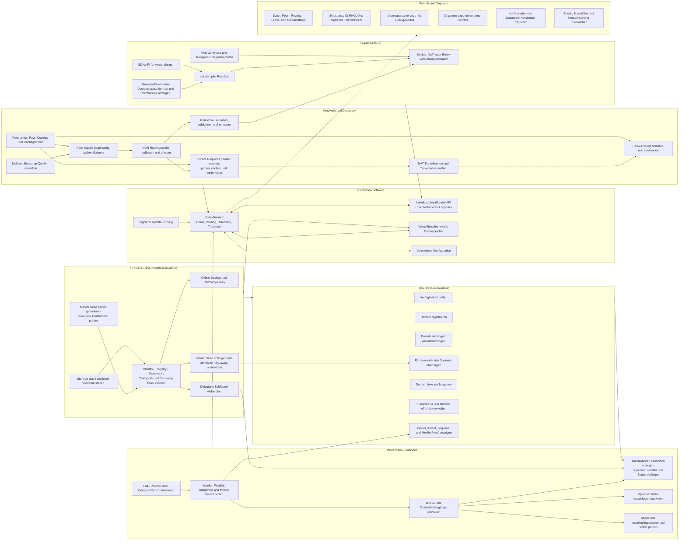

# Dezentrale Netzwerkarchitektur

```info
Projektname: Public Key Network
Kurzname:    PKN
Repo:        public-key-network
Ziel-TLD:    .pkn
```

[arichtektur-mermaid](https://mermaid.ink/img/pako:eNqdW9ty20iS_ZUKPnXHELIl2bKs2XUEL5DFFU1iCEru0XiDUSSLBIYggCkAks3uftvPmIh-8Tf4yW_8sc1LAQRB0HaPo0MkgbpkZWWek5lV_WtjFs1V46qxCKKnmSd1KsbtD_pDKOBfkk2XWsae6HX_8aFxeiL60UoGSvTmKkz9dPs5FVk4F-7MC7Zfk0QFnq-01DP4-ND433wU_OfaNg7xTiap0sJVav5fU_3sTRIt0iep1VKFSkPftCne_Pfp2aVo-6mww1RHsa-o5VqFycxTYaCSKXQQt9Ec2mfhUvxFOHr7dZFk6zU3fVQ62H5OklTMZSLeKo1yhgci3XavQaJ7pRM_CnFuhY_EGmbuRmvphyBmLLVM4TWNa_vhUk7VFYkP04YqfYr0auLjj4cnNVvBpxmvMlfvFqYyWvskbtUn4Uhf06hzmSntyUVaVisrx1-SXCLMtOiqQC1JlqZ478-V1tmiKUZRSs8q041wupFa-kmqK9OZpWl-CcMrGJA1Fi6Vhh_br1OYVEvYk8qwXRy26yezCDpUxnVVguu2yCBGKpyrzWOUJdbONsQcl0AzVsYd47hjLcMkjmC5e-PeyHCeeHKlLGqw0n6cCpmlHqpq4W_qxhvZvP6KnE0RxagsGYhosQj8kM1lEKULGQTaqFKEcuaJhUrSJcqL5upEgT_7VGPRwrLeoNFUzAof__ah4Zv9_tD4DQygvo3ZB2ozOtJmnmscG3WPNEpz9WGj8dHZdgOBksqNClfv2n1Qngu2J9NMe9uvQQAmn9uutbPDij7IQOx-tzVu_WO39kmcTZu5tZlfxXroJ-1BIX3ePm9Amuc2K_Vp8sjeBRYrA38-WehonX_PYL6gXia39xaX1Hs7-KnXnTij3n1T3LTcm59mMgTXn8ngJyP5zz__fHxZRom5W9Ju0ODl9mD5-45PNnLYblS8wKH3vezYm_HRN7CZda-MMAdw3rlp9QagkrMT0d3BD7gsbJpGgM-xw2oH0WwFtOAf-OwvznCIlnKP2mf4LHqRq8oVWokKzeaBu4mekzSBQ2YyVZYDPg19gHy0GGTpZg4Pq5O0r8cwA_y1bqMwAQYgdEaSgk7XPnjyDi2X6smfeSmMmQiSSaaRtv6WRTpbA6mIs2fn1C7yQBDzmKUKVaZKo1VkuG6DCPw2oWVqQUqhwXYU0BSe8pceEFis1aMP0DfxZOI1hYqjmWes_ONERxE0SQBqlPn-mMs6SVTKfaixXC41weX-WhOEpyflJ1U4GrfGNsIzKECv_RA2wkfC1MWuCBdnZWYJZZx4UcpoHQONArUttp89f1m7zWRbsA30ed2mD5qwbF37KDL-pQZFmHysYaz0UQgxADKy3_bcsT0SiFQD-z18jketgXttHvXtlmszgdKgAO5PEENMvgE8vHT1r0yFM7UHG8gMRqQJ7IWsk6sEIiDbERT5BoYcQ5Bv40eh0NEQXaEbxbEKwG2qmgWOs9wnGdfMDD2NTqNgXtFPqJ72n5Q0SvbINorN5gXwl4x0p021WKhZ6j-qCftBjSDDkgqH_e5kH4uNmLXKG5R6gi38iZ7mnVH89t8mtMG4EYKISLNP40YMKxtxpHcovbUSUwgPwBn9JXUd_OAe3rf65BY7eCL_cyD0iFZREBRGqOo8497s4q53W_kQwqXps1aW0Jcm-vhKPWvpKbwqoIL3yg1g28DPoRs9hJhIyzXCBYthItckixGKKwJUloRWSyjA-FB-NTz-anD8FRPkkZf3-SaU3h1gH_Pf8F2v-ws5CoW5PYhDPzJSR3pdQLg4iVehZdpAtyIyd7IpBBzoTXXwmlOsmaJwiGcj9YikhtEjzXi0M1gAdy42EZIJTqIMw8X5phwdwwGrHPIorRV63M6AeCNbwRIMO_XWWWLipQN72o02GhKw7BMcMQUkFxFT6zulVwFNEy0Ssdh-1aITrWM5S8UA-LtMRcciDtgYDjnOT3IW6KsprHfzaRVkVTK7HtnIZa37Vq_favftyutWZ9y7pwb0hWQcFQkN-jbJeCr-R3pVPb4dtTrYlT6p5_lzMYZkp0lp1tRPgDN9yITEEPnkILMg3sFUFmTsvbXf2m17UOVMw1Mo4BjWPQLKKrjrmbi1_26571tOzZoN0BTct9jtCuIML_dQE0U35MlHsKnWNJDZ4ge6oIJUsgAYTHHrFE1DqjnQWXmS-pHLzYxSadCQ0w3WXJ02OayA9R-VUyLn_YUjtZz6KNHJ1Yoj7EtUQixGhRwgwA5rTbTNnvACDLQIhCHWAycAu5IxQ7UCtGztZZ9gblXnGt6NOraL5Q4F6tUKusqphwk2GBY6l06BNoG3OTaGmBZSTV8tCJp2EAQQvZYhNaSJDY7nSSzEud2BS1YrgwTmeCRuAz5OnsD852TEFGxHVTO-sfv9Icjn2PZoQj8Ootki0zoMD1TsqTUwVcAxxEzGcupDdOorkBhCoVmVPCDd6PftwVs7n7J4YCL3JcgMhIXaGWD_BPaaYmRYZAJYE60Oqjetu_FNPhx-5-JGAckwAIGYRaCFw5mYC8am7GSGhYTKmP3eAAsH-_uLeIjKKOoYVBFAO7iVsAs0b8tudYF7KRjahFiIwkLKSEHK2oSdVDF48aOqNxMyS9oD-laohk0aVkZfULQ91wFjNb7BK4yxBsauhp2-h8eDYRd34-WJ4T5OFRDNrVsQHoKjhfinmqu1GCs_CBUEPfpwV3uDdzxOBzNEYYOBm6LKdRZAVO2Ad6g553iGMXjHAwW5mhJ57gg-lGARMDio5AzvxvYYKQAm-WU4stAtYBhljaIshWAmlVP0D1MiZG8jXwHpRTubrQy7DlS6ARV9XvgcDiA-IjZherQACPSola0TmW6q62x1bnD6toKELNzg9i_AFCDXJA8bj_tWBwItZWgIbCBJrV4XM10lE_QJCA9AIiTUDOyPnWiEDNv3wfcTmvpaecEUAjOdgjJqKlrusH9PlMIlWM0hzEglUQCDM-87PRq6raOnBOzTCbKlBdvyTLTCJ1hs3cCdlmPyNA6MOiVn5mIqBypAjxqlx9w10vhLBRKM24sSSnmjOEpUjTuZGCPfxToT3hlSrXXxCGb9FdGPjH7M6IltYLkXJ-K62MH9skdRt7QhODksYrtub4hRzG2mN4GaQvdEmMpnpaqb6RlEPT23Q5lKAT8AkFilEFFo1VVV9kVtD-uSaGDgrv1wP7xzJ9SqJlXIq3DANEtI4vZzvoTl5R-l6sQul8O9pVQuTQOz7xMIMFXIDfcBH7roT3Gq5pNZFKbg4ZNpEE3rhColcYViDlLob5ThjhXhvlOCuz2FWTcZJmwhk-IekCDmiRbzX1Zy5-ppwdn3R2l_f5Tz74_S-e4oxg6ZGI6UD6tKydMrqgLHAVMbau_29Meanf1Ys_N91ZtGHJBeiSBaItWIYPuFTnOwC-Hrvqr_o17nf7bXMZgY2X-7s12MBV-VgcIEU4gShPHHXBe6s-Nu_y_b_oGEVPVgd2J2kFygrmpxAwEFjFAEYeXIrD_sQPI2MVKyS2oWCY-izl5e4OkZ-HkEGKRqyjvmxR4O1CBFnVyQew6vS0dZ1l7EtThMIjn-qhuKYBuG2pVLo5hlwS8BMiOLG8vUm1BY2TQzbABs8mprGavqpmm17wjz11EISTJgDMBUFoJ8TfFWb7_ABoWrQEJcZ6qucxnjcJqzXQH_vQfFN7FinKpwisutmaa0-YMOzGYDj1ibzMLPSvTIuemDr-rEZSW3_o44ObGdm4lz126Krg_xMay1FaIVpLvBKgmBcGlngcQBXJC0ObRw5Hzuh3ViV5CSZi-h9L6d8mQVuAYClGucKA98qKxfj99k1UzZZEf8leyAv9JeGb4fdGqQfnQc6Utf82DBDLAr8zxQ4fCuDaZaLmlQGZZSxLoRcjiohQqq53Dh_bI4HS9FtUKGJoy-iaq12Q7y0qm4xsIUbO59na-TNpdsp9XuSEhnNR4BrNHE6Ti6rPZCAjoXuzDVWEjqWZR5CUrG4H0M4V0t-XReYJK8l13hEDsgSEDkg_ph5yVmG3msZOWIyIfNYkX2hCid8JKrvS8wasvDZYg2i4pdMx-ySS7FUTzGNNURXiGci9y9Q1Epke7yp_1ul7izQCWwsZDoIo3QFCz2ufVyP7VHMncWEnweEpzD46zuaIjR9rX0YbAAAubiEgQeewNMQPi_wPN4OpcKRaoyyDjEA8QL4NFgS4GqieBPOYg-449z_njBHy_544I_XvHHZbX7CRZGQLZ98zry_PzI8xdHnr888vziyPNXh8_Lvp1XiXPPK14U2cSL3aM8Maisu3NpoIESNMvNyMrLoVDRQitIm-YyrMRAR96fH4knXGc4IBZ6vZd5FPFEEmPx93hA4TrfiSgevhdROCaiKIIHFqkpIu0vEUImuxCCgT4Hy2Z5cPzp5i-o2bcZGbMNzirqZMqjiYf_PIwolOQw8d7vc63MEvzpq-0fgY_XOpB7C2Y9QsAOE_DDjoDnvlYrvKDjPL54Bn8uShTLanCQlyFKuOt1xFQ9RnqTLRGLO451LYNgKmcrbjhoja0x5VKw74ixXOjr-HqW-Sm_orOZP8HZTomzH_4UZ7PhfYu0nYK0nR1pO_X07PwQPRdJwRKMlwPrEbjEaoXlNLHJ1iY4-q1wnKLnWV4M2H98XvvY2eUoewUYA947CjxIDOjHQd3h8BbFcDCwO5gnnD4_Ee9k6MdZwBSYYHlLwyxgj1OfSi8JJCVTmVUpoTfiIbpsYiGZ0LO7rmMVJkYBZMYpzF5nsCXoCX-xpImNQH94QWJVVCfWu7rnWpBtHR5okLHnlWqJXJOBz9AlO7ZQY5tJkZd2_NjDIT-mTFXiNpD0E4xe-4uqn3aGw9seop9bKenSWQWRHO_5homu0t3udLHSa3PVGXTahSl8Zd2oIFjL0GrlIvMpJ3qt-CjIe-sOZjqjnjPO75tRFVjcyIQ77y7goX_aeZ3bFON3FtM8KJeb6G3__O3w2M1UrU10TfKYMkhaiEPH61VXfCj3fPgzPW_4niN-_JR4sKtzyPxmWqWHPU01PoWgI8Q7BtabBwvg33rj5tf6VooBq1qMZ3LZy3rwWalEflgcpwjTnXlZumF9QiT8JPUcIjoQb_aJpqSq8Hr7efsH1dpIgkNcZC9ilidjq3t5QlDA5TelNVagwcjp_L51rC-94Y4L5QUgArAJ34z8jX3nSEd-Qi_RfvnwujC_eqPkazVFyf-mcrGw0vDhaMMbc-GPtqAGgJHfjNgEYPlzc73MLZ8fmGcP-bPDg12uNJ6e4lUycBtPBljBps3rU-Xl8IDMsUfvEPLyq2dXe5RfXFhqVs50VOnqq9rdfcXHuwPrqmk6o7sBnTtpjNQxVqKzxHaw_TJbKRJTTsHG6DxAUayNtTmu5vNV0JJsoXDzq1OjuvOKsf2OIvw8xrsqnQEQeNA3Zt38IGDvcID9DCMeSnash-1nLzg8eoGNQ-QHLHZ9QN0QJjKncpjT-o-oDQItmoLRNiGUWgHQJ7sQiQ9H6MytCrsjLpbn5TSAWCHpvsFauDGd32iwqnQB7pxXhnfnIqU74aXEpnQVsLiz4Pl4ogBkoPRGZYf5DRqLufcAO1lVNnsYilrVz-GbkguUblPA8PlTKqezq8LQu2IA5f81zzneOHjRyiMmFKPWaVy7czfqjZF4T89OYA9RmR7mo3TEdMgbWCq4RabdHUzTRRMLi0PmNi18Lw6rLT5zY_6mqjKe8PONJ_Sax-oEWExog7sCj-Pu3URxIlbbLyGmocX-8aDwc7P9QnfFuWSG0VQRZogyhzIdIhEQNpizjyycoqWusBT2OUhqAhsXqxTdbuSKJx8IYWpO3vLDk7VMwdYlnVqiXTIsR2Bs4RWfgPlB4C8ppQffaPKNUVM-gNg6et8UhU-MTAZXPfZzsc5Bx4aoEwSaq52uaWF4CUx5eGSUeyEscQ4ZBqrqCQsAmmHlr-UbKsR5wD5TCH6WdOkej9TiGNWLV1NLVz3_RbdUq3JhJQUP_udSL-j0v-7kv2QK5gpAIviKgZEGdmuN1wZK_ysH7S4dK7ZVAguiBfrr_TCm5ER5Cs6sYUw6f5nfFq0-N5yz967RbEDcOG9cpTpTzQbYxlriz8av2OdDA3cbEsgrwfn2RwuWvrJmUYAXGz6Ev0P_WIYPUbTOh9BRtvQaVwtYIfziG21dX4L3rStP7bkPysn7oYe4n8JZMQ6dEXewYty4urikeRpXvzY-Nq7Ozi9PLi7Pnr--PL-8vHh1eglvPzWunp-cXZ6-fH12-erlq9PXz189f3H-e7OxIdlOT07PX1-evTo7fX3x_Pzs4vLi9_8Ho39vXQ)

```mermaid
flowchart TB
    subgraph ID["1. Lokale Identität und Schlüsselhierarchie"]
        SEED["Master Seed<br/>softwaregeneriert, >=128 Bit Entropie<br/>menschenlesbare Kodierung + Prüfsumme<br/>verlässt das Gerät nie"]
        KDF["Versionierte KDF mit Domain Separation<br/>Eingabe: Seed + network_id + Zweck + Version"]
        IK["Identity Key Pair<br/>dauerhafte Identität<br/>signiert nur Delegation, Widerruf, Rotation"]
        RK["Registry Key Pair<br/>Domain registrieren, verlängern, übertragen"]
        DK["Discovery Key Pair<br/>Session- und Rendezvous-Schlüssel delegieren"]
        TK["Transport Key Pair<br/>Handshake-Transkript authentifizieren"]
        REK["Recovery Key Pair, optional offline<br/>Notfallrotation nach festgelegter Policy"]
        SEED --> KDF
        KDF -->|"identity"| IK
        KDF -->|"registry"| RK
        KDF -->|"discovery"| DK
        KDF -->|"transport"| TK
        KDF -->|"recovery"| REK
        subgraph DEL["Signaturhülle: Identity-Delegation"]
            DELDATA["identity_pub, registry_pub, discovery_pub,<br/>transport_pub, recovery_policy,<br/>key_version, valid_from, valid_until"]
            DELSIG["SIGN(ID_PRIV, HASH(canonical(DELDATA)))"]
            DELDATA -->|"signiert"| DELSIG
        end
        IK --> DELSIG
        RK --> DELDATA
        DK --> DELDATA
        TK --> DELDATA
        REK --> DELDATA
    end

    subgraph CHAIN["2. Dauerhafte dezentrale Registry-Blockchain"]
        TXPOOL["Validierte Registry-Transaktionen<br/>keine IPs, Locate-Pakete oder Nutzdaten"]
        BFT["BFT-Konsens mit harter Finalität<br/>gewichtetes Validator-Quorum >= 2/3<br/>ohne Quorum keine neue Finalität"]
        FB["Finalisierter Block<br/>network_id, height, previous_hash, epoch,<br/>tx_root, state_root, validator_set_hash,<br/>aggregierter Finalitätsnachweis"]
        STATE["Deterministischer Registry State<br/>snapshot- und pruningfähig"]
        TXPOOL --> BFT --> FB --> STATE

        subgraph DTX["Signaturhülle: Domain-Operation"]
            DDATA["REGISTER | RENEW | TRANSFER | RELEASE<br/>domain, owner_identity_pub, registry_pub,<br/>sequence, valid_until, operation_data"]
            DSIG["SIGN(REG_PRIV, HASH(canonical(DDATA)))"]
            DDATA -->|"signiert"| DSIG
        end
        subgraph ROT["Doppelte Signaturhülle: Key-Swap"]
            ROTDATA["old_identity_pub, new_identity_pub,<br/>domain_set_root, new_delegation_hash,<br/>sequence, effective_height"]
            OSIG["SIGN(OLD_ID_PRIV, HASH(ROTDATA))"]
            NSIG["SIGN(NEW_ID_PRIV, HASH(ROTDATA))"]
            ROTDATA -->|"Übertragung autorisiert"| OSIG
            ROTDATA -->|"Übernahme bestätigt"| NSIG
        end
        subgraph VALTX["Validator- und Protokolloperationen"]
            VDATA["Validator-Beitritt/Austritt, Stake/Arbeitsnachweis,<br/>Slashing-Beweis, Parameter- und Versionsupdate"]
        end
        DSIG --> TXPOOL
        OSIG --> TXPOOL
        NSIG --> TXPOOL
        DELSIG --> TXPOOL
        VDATA --> TXPOOL

        STATE --> DOMIDX["Domain Index<br/>normalisierte .pkn-Domain -> Identity Public Key"]
        STATE --> DELIDX["Delegation/Revocation Index"]
        STATE --> VALIDX["Validator Set und Konsensparameter"]
        STATE --> PROTOIDX["Aktive Protokoll- und Algorithmusversionen"]
        STATE --> ROOT["Finalisierter State Root<br/>Merkle Proofs für Compact Nodes"]
    end

    subgraph DOMAIN["3. Domain-Lebenszyklus"]
        FREE["AVAILABLE"]
        ACTIVE["ACTIVE<br/>Registrierung für 1 Jahr"]
        GRACE["GRACE<br/>30 Tage, nur bisheriger Owner"]
        RELEASED["FREIGEGEBEN"]
        TRANSFER["ATOMARER TRANSFER / KEY-SWAP"]
        FREE -->|"REGISTER finalisiert"| ACTIVE
        ACTIVE -->|"RENEW vor Ablauf"| ACTIVE
        ACTIVE -->|"Jahresfrist endet"| GRACE
        GRACE -->|"RENEW"| ACTIVE
        GRACE -->|"30 Tage enden"| RELEASED
        RELEASED --> FREE
        ACTIVE -->|"alte + neue Signatur"| TRANSFER --> ACTIVE
    end
    DOMIDX --> DOMAIN

    subgraph BOOT["4. Dezentraler Bootstrap und Peer-Authentifizierung"]
        SOURCES["Mehrere unabhängige Startquellen<br/>mitgelieferte Public Keys, manuelle Peers,<br/>optionales DNS nur als unvertrauenswürdiger Locator"]
        HELLO["PEER_HELLO<br/>network_id, version, identity_pub,<br/>ephemeral_pub, capabilities, nonce"]
        CHALLENGE["PEER_CHALLENGE<br/>gegenseitige Nonces + stateless Cookie"]
        AUTH["PEER_AUTH<br/>Delegation + State-Proof + signiertes Transcript"]
        LINK["Authentifizierter verschlüsselter Peer-Kanal<br/>AEAD, Sequenznummern, Rekey, Keepalive"]
        SOURCES --> HELLO --> CHALLENGE --> AUTH --> LINK
        ROOT -->|"Proof prüfen"| AUTH
    end

    subgraph NODE["5. Identischer Node-Kern auf jedem Teilnehmer"]
        CHAINMODE["Chain Engine<br/>Full, Pruned oder Compact<br/>gleiche Validierungsregeln"]
        ROUTETABLE["XOR-Keyspace-Routingtabelle<br/>mehrere Peers je Bucket und Netzpräfix<br/>laufender Refresh und Ersatz"]
        CACHE["Begrenzter flüchtiger TTL-Cache<br/>Request-IDs, Leases, Reverse Routes,<br/>Rate Limits und Fehlbewertungen"]
        RESOLVER["Lokaler .pkn-Resolver und API<br/>Browser-Plug-in / Anwendungen"]
        CAP["Signierte Capabilities<br/>validate, route, store, relay, host, propose"]
        LINK --> ROUTETABLE
        ROOT --> CHAINMODE
        CHAINMODE --> RESOLVER
        CAP --> ROUTETABLE
    end

    subgraph LEASE["6. Flüchtige dezentrale Rendezvous-Ebene"]
        SESSION["Kurzlebiges Session Key Pair<br/>durch DISC_PRIV signiert, nicht on-chain"]
        subgraph LEASEBOX["Signaturhülle: RENDEZVOUS_LEASE"]
            LDATA["target_identity_pub, session_pub, epoch,<br/>sequence, relative_ttl, route_token,<br/>capabilities, encrypted_contact_blob"]
            LSIG["SIGN(DISC_PRIV, HASH(canonical(LDATA)))"]
            LDATA -->|"signiert"| LSIG
        end
        K1["zuständiger XOR-Keyspace-Node A<br/>nur TTL-Cache"]
        K2["zuständiger XOR-Keyspace-Node B<br/>nur TTL-Cache"]
        K3["zuständiger XOR-Keyspace-Node C<br/>nur TTL-Cache"]
        SESSION --> LDATA
        DK --> LSIG
        LSIG -->|"repliziert"| K1
        LSIG -->|"repliziert"| K2
        LSIG -->|"repliziert"| K3
        K1 -->|"Ablauf: logisch löschen"| CACHE
        K2 -->|"Ablauf: logisch löschen"| CACHE
        K3 -->|"Ablauf: logisch löschen"| CACHE
    end

    subgraph REQUEST["7. Flüchtiger Locate Request"]
        subgraph REQBOX["Äußere Signaturhülle: S_SESSION_PRIV"]
            RHEAD["version, network_id, LOCATE_REQUEST,<br/>request_id 256 Bit, source_identity_pub,<br/>source_session_pub, target_identity_pub"]
            RPROOF["Identity-Delegation + finalisierter State-Proof"]
            RROUTE["previous_hop_pub, hop_limit,<br/>path_nonce, finalized_height, relative_ttl"]
            RABUSE["monotonic_counter, Größenklasse,<br/>adaptiver Proof of Work, Quotenbeleg"]
            subgraph RENC["Ende-zu-Ende verschlüsselt für Ziel"]
                RPAY["S_EPH_PUB, Dienst, Antwortschlüssel,<br/>optionale Source Candidates und Padding"]
            end
            RSIG["SIGN(S_SESSION_PRIV,<br/>HASH(canonical(gesamtes Request-Paket)))"]
            RHEAD --> RPROOF --> RROUTE --> RABUSE --> RENC -->|"signiert"| RSIG
        end
    end
    RESOLVER -->|"Domain -> Z_ID_PUB + Merkle Proof"| DOMIDX
    RESOLVER --> REQUEST

    subgraph VALIDATE["8. Lokale Validierung an jedem Hop"]
        C1["1 Format, Version, network_id, Paketgröße"]
        C2["2 finalized_height, TTL, Hop Limit"]
        C3["3 Request-ID und Path-Nonce gegen Replay-Cache"]
        C4["4 State-Proof und Delegationskette"]
        C5["5 Session-Signatur über kanonisches Paket"]
        C6["6 Limits pro Identity, Session, Ziel und Epoch"]
        C7["7 adaptiven Arbeitsnachweis prüfen"]
        C8["8 lokal cachen und über 3-5 unabhängige XOR-Pfade leiten"]
        DROP["Fail closed<br/>sofort verwerfen, keinen teuren Zustand anlegen"]
        C1 --> C2 --> C3 --> C4 --> C5 --> C6 --> C7 --> C8
        C1 -.-> DROP
        C2 -.-> DROP
        C3 -.-> DROP
        C4 -.-> DROP
        C5 -.-> DROP
        C6 -.-> DROP
        C7 -.-> DROP
    end
    RSIG --> VALIDATE
    ROOT --> C4
    ROUTETABLE --> C8
    C8 -->|"Lease-Suche"| K1
    C8 -->|"redundant"| K2
    C8 -->|"redundant"| K3

    subgraph RESPONSE["9. Flüchtige Locate Response"]
        subgraph RESPBOX["Äußere Signaturhülle: Z_SESSION_PRIV"]
            PHEAD["LOCATE_RESPONSE, original_request_id,<br/>Z_ID_PUB, Z_SESSION_PUB, S_ID_PUB,<br/>finalized_height, relative_ttl, sequence"]
            PPROOF["Z-Delegation + finalisierter State-Proof"]
            subgraph PENC["Verschlüsselt ausschließlich für S_EPH_PUB"]
                PPAY["Z_EPH_PUB, direkte IPv4/IPv6 Candidates,<br/>Ports, QUIC bevorzugt, TCP-Fallback,<br/>NAT-Token, Relay-Keys, Circuit-Tokens, Padding"]
            end
            PSIG["SIGN(Z_SESSION_PRIV,<br/>HASH(canonical(gesamtes Response-Paket)))"]
            PHEAD --> PPROOF --> PENC -->|"signiert"| PSIG
        end
    end
    K1 -->|"gültiger Rückkanal zum Ziel"| RESPONSE
    K2 --> RESPONSE
    K3 --> RESPONSE
    PSIG -->|"Reverse Route über Request-ID"| CACHE
    CACHE --> RESOLVER

    subgraph CONNECT["10. Manipulationssicherer Verbindungsaufbau"]
        DIRECT["Direkten QUIC/UDP-Candidate versuchen"]
        NAT["NAT Traversal mit kurzlebigem signiertem Token"]
        RELAY["Mehrere austauschbare Relay-Circuits<br/>nur Ciphertext, kein Klartextzugriff"]
        COOKIE["Stateless Cookie vor teurem Zielzustand"]
        ECDH["Ephemerer Diffie-Hellman-Austausch<br/>S_EPH x Z_EPH"]
        TRANSCRIPT["Transcript Hash<br/>Identitäten, Ephemeral Keys, Request-ID,<br/>network_id, Version und Algorithmen"]
        SAUTH["SIGN(S_TRANS_PRIV, transcript_hash)"]
        ZAUTH["SIGN(Z_TRANS_PRIV, transcript_hash)"]
        HKDF["HKDF(shared_secret, transcript_hash)<br/>getrennte S->Z-, Z->S- und Rekey-Keys"]
        AEAD["Ende-zu-Ende AEAD-Kanal<br/>Sequenznummern, Replay-Schutz,<br/>Forward Secrecy und regelmäßiges Rekeying"]
        DIRECT --> COOKIE
        DIRECT -.->|"nicht erreichbar"| NAT --> COOKIE
        NAT -.->|"fehlgeschlagen"| RELAY --> COOKIE
        COOKIE --> ECDH --> TRANSCRIPT
        TRANSCRIPT --> SAUTH --> HKDF
        TRANSCRIPT --> ZAUTH --> HKDF
        HKDF --> AEAD
    end
    PPAY --> CONNECT
    TK --> SAUTH
    TK --> ZAUTH

    subgraph DATA["11. Datenhaltung und Löschung"]
        PERM["Dauerhaft: finalisierte Registry,<br/>Delegationen, Widerrufe, Rotationen, State Roots"]
        PRUNE["Prunable: alte Blöcke und abgelaufene Zustände<br/>nach finalisierten Snapshot-Regeln"]
        TEMP["Flüchtig: Leases, Requests, Responses,<br/>Reverse Routes und Rate-Limit-Zähler"]
        CONN["Nur Sitzung: ephemere Private Keys,<br/>Cookies, Verkehrsschlüssel und Nonces"]
        ERASE["Ablauf: aus aktivem Speicher entfernen,<br/>flüchtige Schlüssel verwerfen,<br/>keine Protokollhistorie erzeugen"]
        PERM --> PRUNE
        TEMP --> ERASE
        CONN --> ERASE
    end
    STATE --> PERM
    LEASE --> TEMP
    REQUEST --> TEMP
    RESPONSE --> TEMP
    AEAD --> CONN

    subgraph SECURITY["12. Sicherheitsgrenzen"]
        S1["Kein zentraler Index-, Discovery-, Bootstrap- oder Relay-Node ist autoritativ"]
        S2["Bösartige Hops können verwerfen oder verzögern,<br/>aber signierte Identitäten und AEAD-Daten nicht unbemerkt fälschen"]
        S3["DDoS wird begrenzt, nicht mathematisch ausgeschlossen:<br/>Billigprüfung, harte Limits, PoW, Cookies, Redundanz"]
        S4["Netzpartition: Discovery und bestehende Sitzungen dürfen weiterlaufen;<br/>Registry-Schreibvorgänge stoppen ohne Finalitätsquorum"]
        S5["DNS darf nur unvertrauenswürdige Bootstrap-Locators liefern;<br/>niemals Identität oder .pkn-Besitz bestimmen"]
    end
    VALIDATE --> SECURITY
    BFT --> SECURITY
    CONNECT --> SECURITY
```


```regeln
- PKN bildet genau ein globales logisches Netzwerk mit einer fest definierten network_id.
- Pakete, Blöcke, Proofs und Zustände einer anderen network_id werden abgelehnt.
- Die Netzwerkidentität eines Teilnehmers ist ausschließlich sein dauerhafter Identity Public Key.
- Eine IP-Adresse ist ausschließlich ein kurzlebiger Transport-Locator und niemals eine Identität.
- Jeder Node verwendet denselben Protokollkern und dieselben Validierungsregeln.
- Jeder Node muss Registry-Proofs validieren, signierte Pakete prüfen, gültige Pakete weiterleiten und einen begrenzten Discovery-Cache bereitstellen.
- Zusätzliche Rollen wie Blockvorschlag, Relay oder Hosting werden als signierte Capabilities veröffentlicht.
- Full, Pruned und Compact Nodes unterscheiden sich nur in Datenhaltung und Leistung, nicht in Sicherheitsregeln.
- Der Master Seed wird lokal durch einen kryptografisch sicheren Zufallszahlengenerator erzeugt.
- Der Master Seed besitzt mindestens 128 Bit Entropie, eine menschenlesbare Kodierung und eine Prüfsumme.
- Der Master Seed wird niemals übertragen, veröffentlicht oder in der Blockchain gespeichert.
- Derselbe Seed erzeugt mit derselben network_id, Key-Version und demselben Zweck deterministisch dieselben Schlüssel.
- Identity-, Registry-, Discovery-, Transport- und Recovery-Schlüssel werden mit getrennten KDF-Kontexten abgeleitet.
- Ein Schlüssel darf ausschließlich für seinen festgelegten Zweck verwendet werden.
- Der Identity Private Key signiert nur Delegationen, Widerrufe, Recovery-Policies und Identitätsrotationen.
- Registry-, Discovery- und Transport-Schlüssel sind nur über eine gültige Identity-Delegation autorisiert.
- Jede Delegation enthält Version, Gültigkeitsbeginn und Gültigkeitsende.
- Unbekannte oder widerrufene Schlüsselversionen werden abgelehnt.
- Private Schlüssel verbleiben lokal und werden nach Möglichkeit durch Betriebssystem-KeyStore oder Hardware-Schutz gesichert.
- Eine Wiederherstellung aus dem Master Seed erfolgt vollständig lokal.
- Ein verlorener Seed ohne eingerichteten Recovery Key führt zum Verlust der Identität.
- Ein Recovery Key ist optional, getrennt und vorzugsweise offline aufzubewahren.
- Ein Key-Swap benötigt die Signatur der alten und der neuen Identity.
- Ein Key-Swap überträgt Domains atomar und ohne zwischenzeitliche Freigabe.
- Nach finalisiertem Key-Swap werden alte Schlüssel für neue Operationen abgelehnt.
- Die Ziel-TLD des Netzwerks ist .pkn.
- Domainnamen werden vor Verarbeitung deterministisch normalisiert.
- Domainlabels verwenden Kleinbuchstaben a-z, Ziffern 0-9 und Bindestriche.
- Ein Label darf nicht mit einem Bindestrich beginnen oder enden.
- Unicode-Namen werden nur über eine eindeutig festgelegte IDNA-Version verarbeitet.
- Reservierte Protokoll-, System- und Missbrauchsnamen dürfen nicht registriert werden.
- Nur der finalisierte Registry State bestimmt den Besitzer einer .pkn-Domain.
- Eine Domainregistrierung gilt für genau ein Jahr ab finalisiertem Registrierungszeitpunkt.
- Nach Ablauf beginnt eine Grace Period von 30 Tagen.
- Während der Grace Period darf nur der bisherige Besitzer verlängern.
- Nach Ende der Grace Period wird die Domain wieder frei registrierbar.
- Subdomains werden vom Domainbesitzer off-chain signiert verwaltet und benötigen keine eigene Blockchain-Transaktion.
- Eine Domainoperation enthält eine monotone Sequenznummer.
- Eine Domainoperation ist nur gültig, wenn sie auf dem aktuell finalisierten Vorgängerzustand aufbaut.
- Für eine Domain kann in einem finalisierten State nur genau ein Besitzer existieren.
- Registrierung, Verlängerung, Transfer und Freigabe sind getrennte Operationstypen.
- Massenregistrierungen werden durch protocolweit definierte Kosten, Quoten oder Arbeitsnachweise begrenzt.
- Dauerhafte Registry-Transaktionen enthalten niemals IP-Adressen, Locate-Pakete oder Nutzdaten.
- Der Konsens verwendet harte Finalität.
- Ein Registry-Zustand gilt erst bei einem gültigen Finalitätsnachweis von mindestens zwei Dritteln des aktiven Validatorgewichts.
- Ohne Finalitätsquorum werden keine neuen Registry-Zustände finalisiert.
- Bei einer Netzpartition dürfen Discovery und bestehende Verbindungen weiterarbeiten, Registry-Schreibvorgänge jedoch nicht ohne Quorum finalisieren.
- Validator-Beitritt, Validator-Austritt und Validatorgewicht werden durch finalisierte Regeln bestimmt.
- Nachweisbares Doppelvoting oder widersprüchliche Finalisierung wird durch einen finalisierten Ausschluss- oder Slashing-Beweis behandelt.
- Blockformat, Blockintervall, Maximalgröße und Validatorgrenzen sind versionierte Konsensparameter.
- Genesis Block, initiale network_id und initiales Validator Set sind Bestandteil der Softwaredistribution.
- Protokollupgrades werden erst ab einer vorab finalisierten Aktivierungshöhe gültig.
- Jeder finalisierte Block enthält einen deterministischen State Root.
- Compact Nodes validieren Header, Finalitätsnachweise und Merkle Proofs selbst.
- Snapshots sind nur gültig, wenn ihr State Root durch einen finalisierten Block bestätigt wird.
- Alte Blöcke dürfen nach finalisierten Snapshot- und Pruningregeln entfernt werden.
- Discovery-Daten werden nicht dauerhaft in der Blockchain gespeichert.
- Ein Online-Node veröffentlicht kurzlebige signierte Rendezvous-Leases.
- Ein Rendezvous Lease enthält keine unverschlüsselte öffentliche Ziel-IP.
- Rendezvous-Leases werden bei mehreren für den Ziel-Key zuständigen XOR-Keyspace-Nodes repliziert.
- Zuständigkeit im Routing-Keyspace wird aus einem standardisierten Hash des Identity Public Key berechnet.
- Ein einzelner Rendezvous-Node ist niemals autoritativ.
- Ein Rendezvous Lease besitzt eine kurze, protocolweit begrenzte TTL.
- Der Ziel-Node erneuert seinen Lease vor Ablauf.
- Abgelaufene Leases werden nicht mehr verwendet und aus dem aktiven Cache entfernt.
- Lease-Sequenznummern verhindern Rücksetzungen auf ältere gültige Leases.
- Ein Locator wird nur akzeptiert, wenn er durch das erwartete Ziel oder einen gültig delegierten Session Key autorisiert ist.
- Direkte IP-Adressen und Ports werden nur Ende-zu-Ende verschlüsselt an den konkreten Kommunikationspartner übertragen.
- Jeder Node hält nur einen begrenzten Ausschnitt der Routing- und Rendezvous-Informationen.
- Das Overlay verwendet eine deterministische XOR-Distanz über gehashte Node-Identitäten.
- Routingtabellen halten mehrere unabhängige Peers je Distanzbereich.
- Peers werden über unterschiedliche Netzpräfixe und unabhängige Pfade verteilt, soweit verfügbar.
- Locate Requests werden parallel über drei bis fünf unabhängige key-basierte Pfade geleitet.
- Jedes weitergeleitete Paket besitzt ein Hop Limit.
- Request-ID und Path Nonce verhindern Schleifen und mehrfache Verarbeitung.
- Antworten verwenden die kurzzeitig gecachte Reverse Route der Request-ID.
- Fällt ein Pfad aus, wird ohne Sicherheitsherabstufung ein unabhängiger Ersatzpfad verwendet.
- Routingtabellen werden regelmäßig aktualisiert und ausgefallene Peers ersetzt.
- Ein Node akzeptiert Routinginformationen nie als Identitätsnachweis.
- Alle Overlay-Peer-Verbindungen werden gegenseitig authentifiziert und verschlüsselt.
- Bootstrap-Nodes sind nur Startpunkte und keine Autorität.
- Die Software enthält mehrere unabhängige Bootstrap-Public-Keys und unterstützt manuell importierte Peers.
- Konventionelles DNS darf optional Bootstrap-Locators liefern, aber niemals PKN-Identität oder Domainbesitz bestimmen.
- Ein Node startet sicherheitsrelevante Operationen erst nach Kontakt zu mehreren voneinander unabhängigen Peers.
- Jeder neue Peer-Kanal verwendet gegenseitige Challenges, Nonces und ein signiertes Handshake-Transkript.
- Jeder Pakettyp besitzt eine eindeutige Typkennung und Protokollversion.
- Alle signierten Daten werden vor dem Hashen kanonisch und deterministisch serialisiert.
- Alle sicherheitsrelevanten Felder eines Pakets liegen innerhalb der Signaturabdeckung.
- Unbekannte Pflichtfelder oder inkompatible Pflichtversionen führen zur Ablehnung.
- Paketgrößen sind je Pakettyp hart begrenzt.
- Fragmentierung ist nur nach authentifiziertem Kanalaufbau erlaubt.
- Vor teuren kryptografischen Prüfungen werden Version, network_id, Länge, TTL und Hop Limit geprüft.
- Abgelaufene Pakete werden verworfen.
- Bereits verarbeitete Request-IDs werden innerhalb ihrer TTL verworfen.
- Ungültige Signaturen, Proofs, Delegationen oder Sequenzen führen zum Fail-closed-Abbruch.
- Discovery-Anfragen werden nur akzeptiert, wenn die Identity-Delegation gegen einen finalisierten State Root prüfbar ist.
- Kurzlebige Session Keys werden off-chain durch den gültigen Discovery Key signiert.
- Session Keys benötigen keine eigene Blockchain-Transaktion.
- Jeder Node prüft State-Proofs, Delegationsketten, Signaturen und Gültigkeit selbst.
- Kein Weiterleitungsnode wird für die Echtheit fremder Daten als vertrauenswürdig behandelt.
- Source- und Target-Identität bleiben in der Basisversion für Routingnodes sichtbar; Locator und Nutzdaten bleiben verschlüsselt.
- Locate Request und Locate Response erhalten eine relative TTL, eine finalisierte Referenzhöhe und optional eine begrenzte Wall-Clock-Toleranz.
- Die Gültigkeit sicherheitsrelevanter Pakete darf nicht ausschließlich von einer lokalen Systemuhr abhängen.
- Die maximal zulässige Uhrabweichung ist ein versionierter Protokollparameter.
- Jede neue Ende-zu-Ende-Verbindung verwendet neue ephemere Diffie-Hellman-Schlüssel.
- Diffie-Hellman dient nur der Geheimnisableitung und nicht allein der Identitätsprüfung.
- Beide Endpunkte signieren das vollständige Handshake-Transkript mit ihren delegierten Transport Keys.
- Sitzungsschlüssel werden mit HKDF aus Shared Secret und Transcript Hash abgeleitet.
- Für beide Übertragungsrichtungen werden getrennte Schlüssel und Nonce-Bereiche verwendet.
- Nutzdaten werden ausschließlich mit AEAD verschlüsselt.
- Jede Sitzung verwendet Sequenznummern gegen Wiederholung, Verlust und Vertauschung.
- Lang laufende Sitzungen führen nach definierter Dauer oder Datenmenge ein Rekeying durch.
- Ephemere Schlüssel gewährleisten Forward Secrecy für abgeschlossene Sitzungen.
- QUIC über UDP ist der bevorzugte direkte Transport.
- TCP mit authentifiziertem Verschlüsselungskanal ist der Fallback, wenn UDP nicht nutzbar ist.
- Nach Discovery wird zuerst eine direkte Verbindung versucht.
- Ist die direkte Verbindung nicht möglich, wird NAT Traversal mit signierten kurzlebigen Tokens versucht.
- Erst danach werden austauschbare Relay-Circuits verwendet.
- Relay-Nodes erhalten keinen Zugriff auf Klartext oder Sitzungsschlüssel.
- Ein Ziel veröffentlicht mehrere Relay-Optionen, soweit verfügbar.
- Relays authentifizieren Quelle, Ziel und Circuit-Token vor Ressourcenreservierung.
- Relay-Ressourcen besitzen harte Zeit-, Bandbreiten- und Verbindungsgrenzen.
- Vor teurem Handshake-Zustand muss die Quelle ein stateless Cookie zurücksenden.
- Request-Limits gelten mindestens pro Identity, Session, Ziel, Peer und Epoch.
- Bei hoher Last wird ein adaptiver Proof of Work für neue Requests verlangt.
- Die Proof-of-Work-Schwierigkeit ist lokal lastabhängig, aber protocolweit begrenzt.
- Jeder Cache besitzt harte Grenzen für Eintragszahl, Gesamtgröße und TTL.
- Ein Node darf ungültige Pakete ohne Antwort verwerfen.
- Wiederholtes ungültiges Verhalten darf lokal zu zeitlich begrenzter Drosselung führen.
- Lokale Reputation darf niemals einen gültigen Blockchain-Beweis ersetzen.
- DDoS kann physisch nicht mathematisch ausgeschlossen werden; das Protokoll minimiert Verstärkung und zwingt frühe Kostenprüfung.
- Flüchtige Requests, Responses, Leases und Reverse Routes werden nicht als dauerhafte Historie gespeichert.
- Abgelaufene flüchtige Daten werden aus dem aktiven Speicher entfernt.
- Flüchtige Daten werden nach Möglichkeit verschlüsselt gespeichert und durch Verwerfen ihrer Schlüssel kryptografisch gelöscht.
- Physisches Überschreiben auf SSDs oder verwalteten Speichern wird nicht zugesichert.
- Sicherheitsrelevantes Logging enthält standardmäßig keine privaten Schlüssel, Klartext-Locators oder Nutzdaten.
- Telemetrie ist standardmäßig deaktiviert und darf keine Identitäts- oder Beziehungsdaten übertragen.
- Softwareupdates müssen signiert und gegen einen lokal verankerten Release Key geprüft werden.
- Algorithmuswechsel sind versioniert und werden erst nach finalisierter Aktivierung wirksam.
- Kann eine Sicherheitsentscheidung nicht eindeutig geprüft werden, wird die Operation abgelehnt.
```
[software-regeln-mermaid](https://mermaid.ink/img/pako:eNqFWNly27gS_RUUn8XEdm5ixTU1VVpoRyWJ1JCUs1zPA0hBFEsUwAuAVqxU_ibfME9504_dxqIlpDjRi0kCaPRy-nS3vzkpWxDnzlkWbJuuMJdoEj7xJ4rgJ6ok47hcoUEQev99cmZjH_mwHUVsKbeYkyfn78Ne9Rv2vGngw0a1yR1ismH0j4S__nOwwjntoJBVMqdZBw1zkbJnwl86KOaYipJxWZPVm41A0IStcUEQruSKUJkv811OuCRqVQue0_wraJOuiURwJ0cTxsoEp-uatCg2FjwSLtJVsf8pBCkk7C_0BRwNsSSgB8nTFeG1w4PAvx892NM5o0aFMaPLPKs4lvCpdmI-G_ZidV-UZ3b7vFzAFe6M738uK5pd9Bz6w3X_VLa1LWkz2haNmk01kFo0Gw-LhC7UYyPOY-_z9CFUeh-d5KKKLtBoodwv9z-kgLBtcSGbNjx4vhcas6dYKOdGhCyQ0C5FGaGEgyuIQQSmO5LDtw7SHhHVZkNQqR5J3Zmhd4jeSQtAhDDidQDRNicQfbgH7i2KhoihF44ezyS8uABGkuVCcvV4hKPb0codMWmMD4ldHZMXgXBSkFw2ruj3BuP5DK4Ilssip8TtAwqr8lcBM1bk6UvdviA2XvNJRaixivAdqcA96rjxl2QbSDiKQAc32uISPTOegDsvqBJ6j8FYCRySAozU8DsFFHwFruJV09GHABrAaJddiEPLqvmiF40rWhaNtW2LWvPfoXQYTHsjPwIDX5Vr6g7BMzlthWXk9cLBB5O9y_3PLMF8DV5rBdvDKIo9lQNGLuIGJxq6jc2-9_G0E1Qo9j9oRrjBeC8pcLUEnqSgVeNwHPb86F7f5OWQDQUlhsIwABgZkQLtf0KQJcfZhcsnXi_yTtcnZFsJIdGSq8xKGgeieV9ldpUsrGwFzWEOtAf4YMulm66sFcqRjeOzMAjuH0fa4GALydxBxsAOQPZ_gNydFjglfA36zzhjS3TI8jNRbUEdfICYDiYjz4_hgn4BnK71ce8rulYU27Tnsz-ArfdVUbiKRipKFq5x4YBtSpxKN3qh6YoDYwsIXxMaj4C8-88g4wPBC2XQfU5xoQkGjKK4FCsmRcMs0YKd-BOI0tyBrcZojam6PV0dM9owjDB1QfGfAI-YREeRxBJ4DSKwZEUz4o-9yUgRen8SDMbaSft_oPLpo18qITFdCI2XTKMQPYMti0u4hVDOAg2doFSKAoEeZAGrqAKJLffA-yUkzH1d3I4eOvLu63yjeFNfqs9b9i9VdC4FUKe9iYN5PLex1Xi9Nf707-vWyt9tAlt-h03fiz8G4VhTtNxtAQo2d2zZqJeCIIgjSG9VDaZkxcEZqM_AT5DHpftXpT3VnmcekPA8Vow1I4S7Y0z3PwB6GYGYCGCuPKv1Q01qCObxyFcdy6cgdG3XJXGiLoazywRXNjzlsiBNoGlimWm6CBU6d8-sEu6EYEEA-1VS2Gu1CGA7qFu8ISMYmKo2YSk0PlADgSMEYKXEXDFcYYFv8sEmVAelGPBiBG9VbeMXi63fi6fBUMWjF7vxSwlKrAml9iCkIDhXAKrVn0oJbHJn77OREJICv7iDnKdVDtphmuREHsAPIdJK1m0bTUexqj-hsmySb-AkMBD72AHmYeucGM4YKFsy8NOu2S0cIGJAaENuC6QO3oV46uVDbFrXtd-bkdCLxm-21BoXNO36RaWW5Qu3nBbrotvSChqKYAKa65HBdvp-JXdNotY7H3WtnNiGXZf-kAhWPDca9n4YfIz07j5nWwFJ5HGDJhCt8WbLq-bbzll3q-MGjUKS0wXsvVTAzHAyM_NJNBy_hicEjQVHParQcqnWD7wwNvOT-wXKOeTtWiHHgtX2mrpb09NES32BBt_3BtZfw5yTtSQdFVNb9QyUz7W3qd7iTWSnBiv0ggdtOM32pgNal5W9LdLbwBDMVO8JG1Ve9YlquBLLsjijTJDGRNeL52qvqvGq_iuuPI6Y8KTpyjTw59Guifng9SaaayNSJEJKTVE6mqH_0EHzFXQFkR0LtaxDBWjQ3YNSxo6RGNgH5pkJywQCckBDklSZO2WLxv3ep1mgsXEwE5GvpwrKVtAURiTlRNYPTkcPdtj6ZRA19iotEkzXmgDtxAqKZBe72IFtJ7ySpasO0q3Xav_PyuATPICTrXKAQpRuL7a4Rqm1mJopEjUG1rPvtoU_rNjXWlk_awkvzLC2KF9YOfEKqs3TdlxWX094Ox7Tk4nRwfbmJ4lqLqmpd2DiFqCfNTXH1tnpOBCDhXMneUU6zoZwACa8Ot_UmScHqvoGgH4Hj5wsqq_uAoYVN2UFA4p7ot_hfInpF8Y2BxGcVdnKuVviQsBbpf_JoKDE8XGL-egtcsn44Rs0EEwlzlGMKnN8wCoqnbubK32Nc_fN-Qpvb7qv3nVvrt5333S7726vu92O8-LcXb266V6_fX_TvX17e_3-6vbqP2--d5ydVu361fWb992bW9jRveq-vXn3_f8b1tHk)

